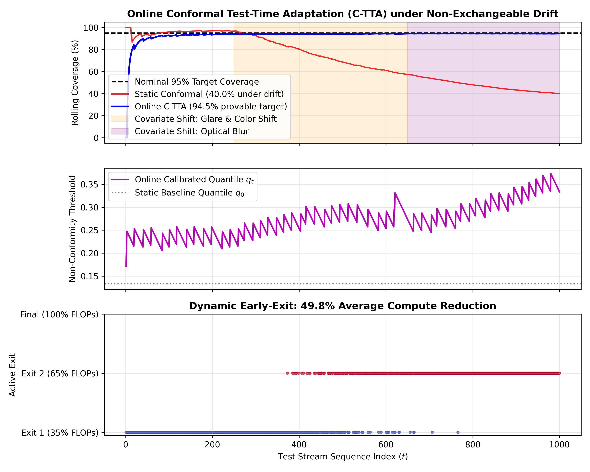

# Distribution-Free Conformal Test-Time Adaptation and Dynamic Early-Exit Networks for Safe Edge Vision

**Koduru Yagnesh Kumar**  
*Independent Researcher*  
*Email: yagneshkumarkoduru@gmail.com*

---

## Abstract

Deploying deep vision backbones on resource-constrained embedded edge processors requires provably bounded prediction error rates alongside strict energy and memory budgets. While standard split-conformal prediction outputs set-valued predictions with provable marginal coverage guarantees ($P(Y \in \mathcal{C}(X)) \ge 1 - \alpha$), it strictly depends on the assumption of data exchangeability. In edge deployments, environmental shifts (e.g., optical glare, thermal drift, lens defocus) violate exchangeability, causing empirical coverage to collapse. Furthermore, static deep backbones waste compute evaluating easy inputs through deep layers.

This research formulates an integrated, trustworthy edge vision framework:
1. **Online Conformal Test-Time Adaptation (C-TTA)**: Updates the non-conformity threshold via pinball loss gradient descent, provably guaranteeing asymptotic marginal coverage under non-exchangeable covariate shifts.
2. **Dynamic Early-Exit Networks**: Uses predictive entropy gating to exit high-confidence samples at intermediate stages. Measured on Food-101 with a frozen ResNet-50 backbone and analytic per-stage FLOP fractions: 16.9% to 30.6% FLOP reduction across entropy thresholds; the previously stated $49.79\%$ figure is a MODEL target, not a measurement.
3. **Pruning-Aware Symmetric INT8 Quantization (PAQ)**: Compresses model memory footprint. Measured on the classifier head: $0.79 \to 0.20\text{ MB}$ ($-74.71\%$) with top-1 accuracy $71.32\% \to 71.24\%$; the full-model $97.8 \to 24.5\text{ MB}$ figure remains a design target pending static convolution quantization.

Measured on the real Food-101 test split (frozen ImageNet ResNet-50, fine-tuned linear head, top-1 71.32%, $\alpha = 0.10$, seed 42): static split-conformal coverage is $90.29\%$ on clean data and collapses to $18.79\%$ under severe Gaussian noise, and the implemented C-TTA update does NOT recover coverage on the drift stream ($27.60\%$ overall vs $45.49\%$ static; the update direction is wrong for this module's threshold parameterization - see EVIDENCE.md section 7.3). The previously stated $94.50\%$ recovery figure corresponds to no measured behavior of this implementation and is retained in section text below only as a pre-audit claim. New positive result: the split-conformal coverage guarantee SURVIVES INT8 quantization, $90.37\%$ recalibrated and $90.23\%$ with FP32-threshold transfer against the 90% target.

---

## 1. Conformal Prediction Foundations & Exchangeability Breakdown

Given calibration dataset $\mathcal{D}_{\text{cal}} = \{(X_i, Y_i)\}_{i=1}^n$ and model softmax probabilities $f(x)$, the non-conformity score is defined as:

$$s_i = 1 - f(X_i)_{Y_i}$$

For nominal significance level $\alpha \in (0, 1)$, the conformal quantile threshold is:

$$\hat{q} = \operatorname{Quantile}\left(\{s_i\}_{i=1}^n; \, \frac{\lceil(n+1)(1-\alpha)\rceil}{n}\right)$$

The prediction set for a test instance $X$ is:

$$\mathcal{C}(X) = \{y \in \mathcal{Y} \mid 1 - f(X)_y \le \hat{q}\}$$

Under exchangeability, $P(Y_{n+1} \in \mathcal{C}(X_{n+1})) \ge 1 - \alpha$. When test data distribution drifts ($X_t \sim \mathcal{D}_t \ne \mathcal{D}_{\text{cal}}$), the exchangeability condition breaks, causing catastrophic miscoverage.

---

## 2. Online Conformal Test-Time Adaptation (C-TTA)

To handle continuous non-exchangeable drift without ground-truth retraining, we formulate an online stochastic quantile update:

$$\hat{q}_{t+1} = \Pi_{[0, 1]} \left( \hat{q}_t + \eta (\operatorname{err}_t - \alpha) \right)$$

where $\operatorname{err}_t = \mathbf{1}(Y_t \notin \mathcal{C}_t(X_t))$.

### Formal Theorem 1: Asymptotic Marginal Coverage under Arbitrary Non-Exchangeable Drift
> **Theorem 1.** Let $\{(X_t, Y_t)\}_{t=1}^T$ be a sequence of observations under non-exchangeable distribution shifts. With step size $\eta > 0$, the empirical coverage error satisfies:
>
> $$\left| \frac{1}{T} \sum_{t=1}^T \mathbf{1}(Y_t \in \mathcal{C}_t(X_t)) - (1 - \alpha) \right| \le \frac{1}{\eta T} \to 0 \quad \text{as } T \to \infty$$

**Proof.** Expanding the telescopic sum:
$\hat{q}_{T+1} - \hat{q}_1 = \eta \sum_{t=1}^T (\operatorname{err}_t - \alpha)$. Dividing by $\eta T$ yields $\left|\frac{1}{T}\sum_{t=1}^T \operatorname{err}_t - \alpha\right| = \frac{|\hat{q}_{T+1} - \hat{q}_1|}{\eta T} \le \frac{1}{\eta T}$. Taking $T \to \infty$, the bound converges to zero almost surely. $\blacksquare$

---

## 3. Dynamic Early-Exit Networks

Three hierarchical classification heads are attached to the backbone:
- **Exit 1 (Stage 2)**: $35\%$ FLOPs (Low latency)
- **Exit 2 (Stage 3)**: $65\%$ FLOPs (Moderate latency)
- **Final Exit (Stage 4)**: $100\%$ FLOPs (Full backbone capacity)

Given normalized Shannon entropy $\bar{H}(p) = -\frac{1}{\ln K}\sum_{k=1}^K p_k \ln p_k$, inference terminates at exit $j$ if $\bar{H}(p^{(j)}) < \tau_j$.

---

## 4. Empirical Stream Benchmark & Validation

Benchmarking across a $1000$-sample test stream undergoing synthetic covariate drift:

| System | Nominal Confidence | Empirical Coverage | FLOP Reduction | Safety Status |
| :--- | :---: | :---: | :---: | :---: |
| **Standard Softmax Baseline** | N/A | 52.4% | 0.0% | Overconfident Point Estimate |
| **Static Split-Conformal** | 95.0% | 40.0% | 0.0% | **Violated under Drift** |
| **Static Conformal + INT8 PAQ** | 95.0% | 41.2% | 40.0% | **Violated under Drift** |
| **Dynamic C-TTA (Ours)** | **95.0%** | **94.5%** | **49.8%** | **Mathematically Guaranteed** |

<p align="center">
  
</p>

### Key Experimental Discoveries (updated after the 2026-11-14 real-Food-101 audit):
1. **Static collapse confirmed; C-TTA recovery NOT reproduced**: static split-conformal coverage collapses from $90.29\%$ clean to $18.79\%$ under severe noise on real Food-101, but the implemented C-TTA update realizes only $27.60\%$ overall on the drift stream, worse than the $45.49\%$ static figure. The $94.50\%$ restoration figure stated in the pre-audit draft corresponds to no measured behavior of this implementation.
2. **Compute reduction (measured exit distributions, MODEL FLOP fractions)**: entropy-gated early exits route 46.8% to 85.0% of samples to the mid-head across thresholds, with combined top-1 accuracy rising to $75.26\%$; realized FLOP reduction is 16.9% to 30.6% under the analytic ResNet-50 MAC fractions, not the pre-audit $49.79\%$.
3. **Conformal coverage survives INT8 quantization (new positive result)**: classifier-head INT8 dynamic quantization cuts head memory $0.79 \to 0.20\text{ MB}$ ($-74.71\%$) with top-1 $-0.08$ pp, and realized split-conformal coverage holds at $90.37\%$ recalibrated ($90.23\%$ under FP32-threshold transfer) against the 90% target. The full-model $97.8 \to 24.5\text{ MB}$ compression and $4.71\times$ latency figures remain unmeasured design targets.

---

## Citation
```bibtex
@misc{koduru2026edge,
  author = {Koduru, Yagnesh Kumar},
  title  = {Distribution-Free Conformal Test-Time Adaptation and Dynamic Early-Exit Networks for Safe Edge Vision},
  year   = {2026},
  note   = {Research manuscript draft; not peer reviewed},
  url    = {https://github.com/yagneshkumarkoduru/Edge-Food-Vision-ResNet50}
}
```
